# Foodie - Food Delivery App

A Flutter food delivery application built based on Pixso UI designs. This app provides a complete food ordering experience with modern UI/UX.

## 📱 Screenshots

### Authentication Flow
| Splash | Onboarding | Sign In | Sign Up | Setup |
|--------|------------|---------|---------|-------|
| 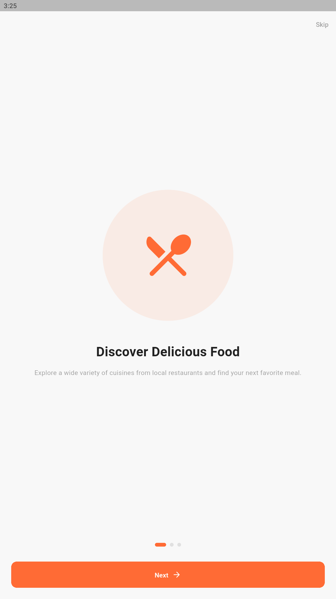 | 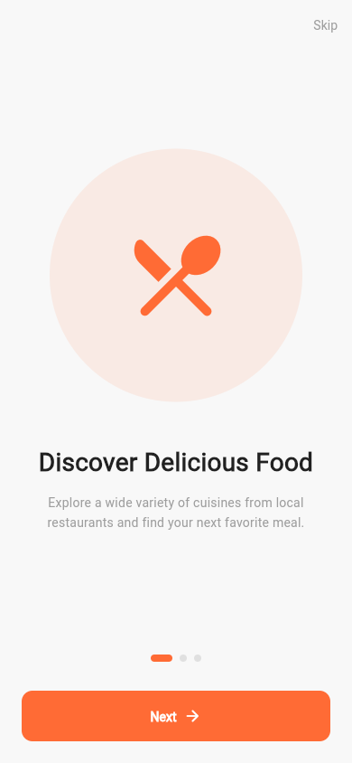 | 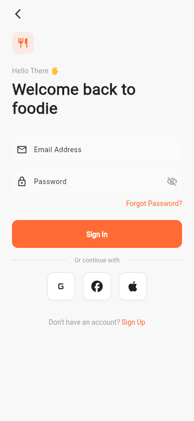 | 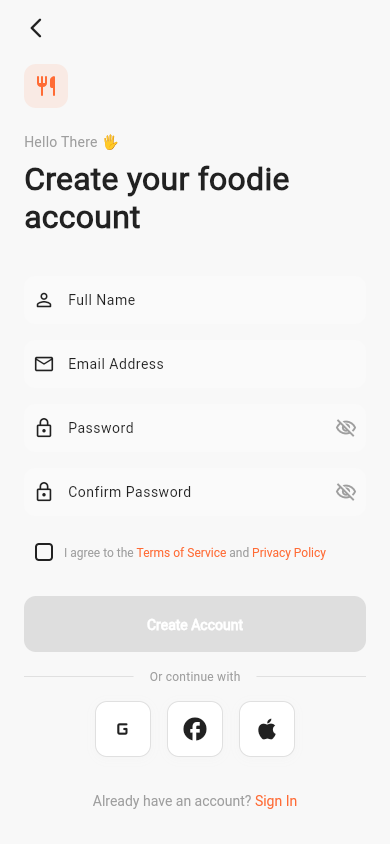 | — |

### Main Features
| Home V1 | Home V2 | Food Detail | Search | Search Results |
|---------|---------|-------------|--------|----------------|
| 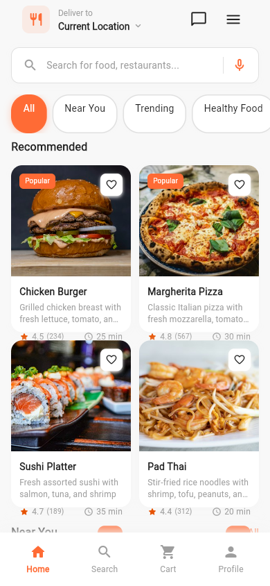 | 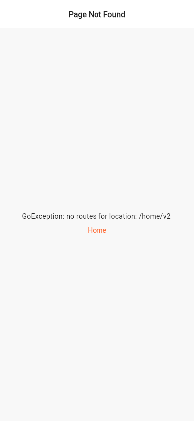 | 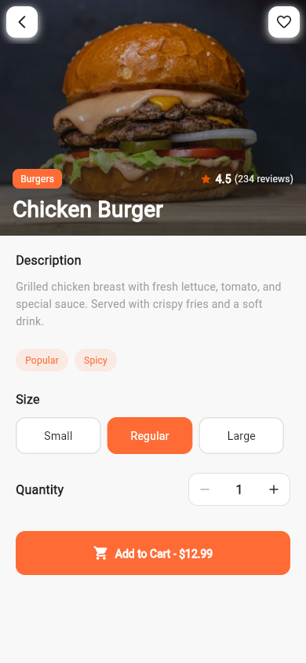 | 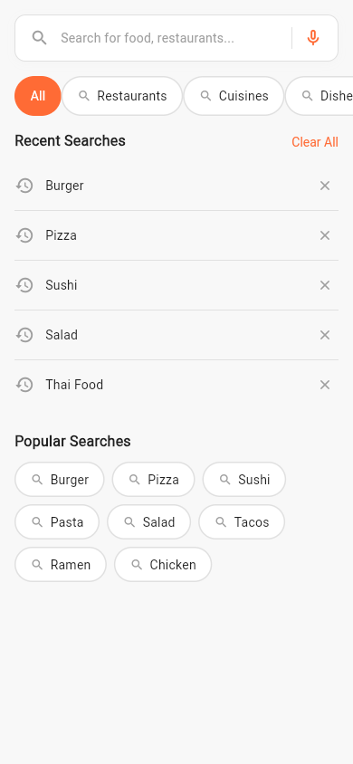 | 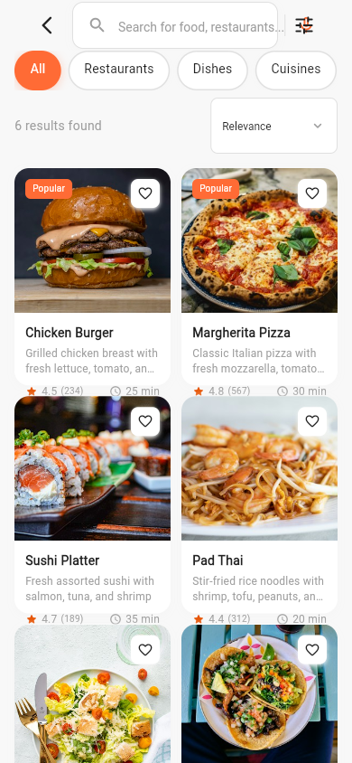 |

### Order & Delivery
| Cart | Order History | Delivery Tracking | Delivery Detail |
|------|---------------|-------------------|-----------------|
| 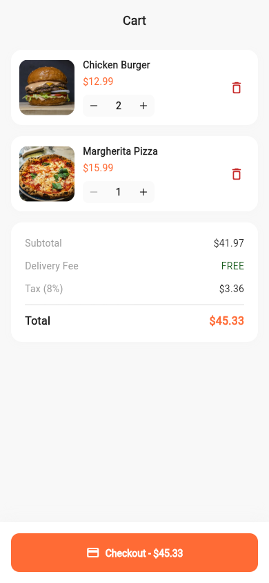 | 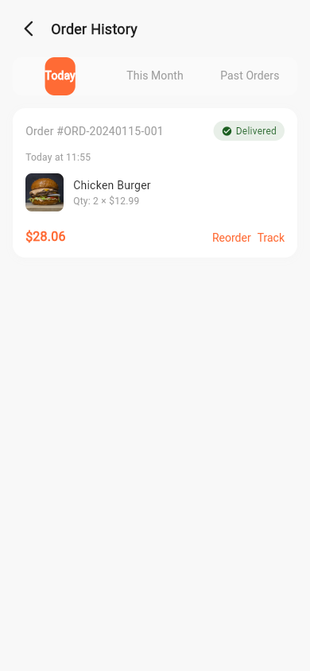 | 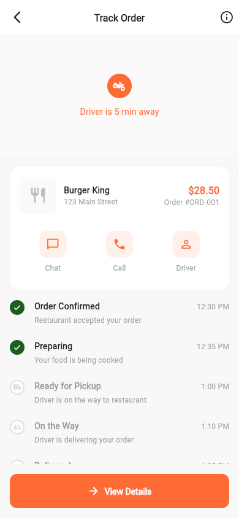 | — |

### Profile & Settings
| Profile | Edit Profile | My Locations | Vouchers | Voucher Detail |
|---------|--------------|--------------|----------|----------------|
| 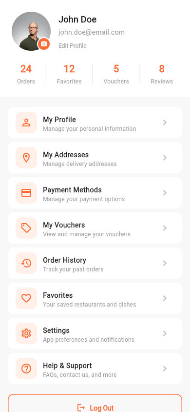 | 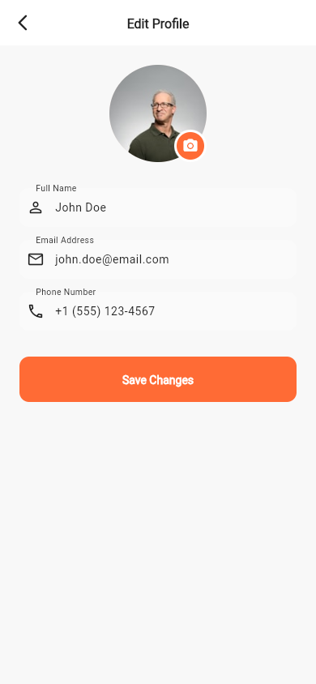 | — | 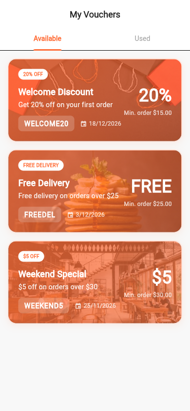 | — |

### Additional Screens
| Chat | Side Menu |
|------|-----------|
| — | — |

## 🏗️ Project Structure

```
lib/
├── main.dart                          # App entry point
├── core/
│   ├── constants/
│   │   ├── app_colors.dart           # Design system colors (from Pixso)
│   │   └── app_text_styles.dart      # Typography system (from Pixso)
│   ├── theme/
│   │   └── app_theme.dart            # Material 3 theme configuration
│   └── router/
│       └── app_router.dart           # GoRouter configuration
├── features/
│   ├── auth/
│   │   └── presentation/pages/
│   │       ├── splash_screen.dart
│   │       ├── onboarding_screen.dart
│   │       ├── sign_in_screen.dart
│   │       ├── sign_up_screen.dart
│   │       └── setup_screen.dart
│   ├── home/
│   │   ├── presentation/pages/
│   │   │   ├── home_screen.dart
│   │   │   ├── food_detail_screen.dart
│   │   │   └── side_menu_screen.dart
│   │   └── presentation/widgets/
│   │       ├── food_card.dart
│   │       ├── category_chip.dart
│   │       └── search_bar_widget.dart
│   ├── search/
│   │   ├── presentation/pages/
│   │   │   ├── search_screen.dart
│   │   │   └── search_result_screen.dart
│   │   └── presentation/widgets/
│   │       ├── search_bar_widget.dart
│   │       ├── recent_search_tile.dart
│   │       └── popular_search_chip.dart
│   ├── cart/
│   │   └── presentation/pages/
│   │       └── cart_screen.dart
│   ├── order/
│   │   └── presentation/pages/
│   │       ├── order_history_screen.dart
│   │       ├── delivery_tracking_screen.dart
│   │       └── delivery_detail_screen.dart
│   ├── profile/
│   │   └── presentation/pages/
│   │       ├── profile_screen.dart
│   │       └── edit_profile_screen.dart
│   ├── voucher/
│   │   ├── presentation/pages/
│   │   │   ├── voucher_screen.dart
│   │   │   └── voucher_detail_screen.dart
│   │   └── presentation/widgets/
│   │       └── voucher_card.dart
│   ├── chat/
│   │   └── presentation/pages/
│   │       └── chat_screen.dart
│   └── location/
│       └── presentation/pages/
│           └── my_location_screen.dart
└── shared/
    ├── models/
    │   └── food_item.dart            # Data models
    └── widgets/
        └── primary_button.dart       # Reusable button components
```

## 🎨 Design System

### Colors (from Pixso)
- **Primary**: Gradient (Orange #FF6B35 → #F7931E)
- **Accent Colors**: Green, Orange, Red, Success scales (10-100)
- **Neutral**: Black, White, Light Grey, Grey scales (10-100)
- **Semantic**: Primary, Secondary, Error, Success, Background, Surface

### Typography (from Pixso)
- **Headline 1**: 22pt (Regular, Medium, Semibold, Bold)
- **Headline 2**: 20pt (Regular, Medium, Semibold, Bold)
- **Headline 3**: 18pt (Regular, Medium, Semibold, Bold)
- **Headline 4**: 16pt (Regular, Medium, Semibold, Bold)
- **Headline 5**: 14pt (Regular, Medium, Semibold, Bold)
- **Bodytext 1**: 14pt (Regular, Medium, Semibold, Bold)
- **Placeholder 1**: 12pt (Regular, Medium, Semibold)
- **Placeholder 2**: 10pt (Regular)

### Effects
- **Dropshadow - 01**: Standard elevation shadow
- **Navbar - Dropshadow**: Bottom navigation shadow
- **Our Ds**: Custom design system shadow

## 🚀 Getting Started

### Prerequisites
- Flutter SDK 3.2.0 or higher
- Dart 3.2.0 or higher
- Android Studio / VS Code
- iOS Simulator / Android Emulator

### Installation
```bash
# Clone the repository
git clone <repository-url>
cd foodie

# Install dependencies
flutter pub get

# Run the app
flutter run
```

### Supported Platforms
- ✅ Android
- ✅ iOS
- ✅ Web (experimental)
- ✅ macOS (experimental)
- ✅ Windows (experimental)
- ✅ Linux (experimental)

## 📦 Dependencies

```yaml
dependencies:
  flutter:
    sdk: flutter
  cupertino_icons: ^1.0.6
  go_router: ^13.0.0          # Navigation
  provider: ^6.1.1            # State management
  flutter_svg: ^2.0.9         # SVG support
  cached_network_image: ^3.3.0 # Image caching
```

## 🧭 Navigation

The app uses **GoRouter** for declarative routing:

```dart
// Main routes
/splash           # Splash screen (initial)
/onboarding       # Onboarding flow
/sign-in          # Sign in
/sign-up          # Sign up
/setup            # Initial setup
/home             # Home screen (main)
/food-detail/:id  # Food detail
/search           # Search screen
/search-result    # Search results
/cart             # Shopping cart
/orders           # Order history
/tracking/:id     # Delivery tracking
/tracking-detail/:id # Tracking detail
/profile          # User profile
/edit-profile     # Edit profile
/my-location      # Saved locations
/vouchers         # My vouchers
/voucher-detail/:id # Voucher detail
/chat             # Messages
/side-menu        # Side menu
```

## 🏛️ Architecture

This app follows **Feature-First Clean Architecture**:

```
features/{feature_name}/
├── data/           # Data sources, repositories
├── domain/         # Entities, use cases, repository interfaces
└── presentation/   # UI layer (pages, widgets, controllers)
    ├── pages/      # Screen widgets
    ├── widgets/    # Reusable UI components
    └── controllers/ # State management (Providers/Blocs)
```

### Key Principles
- **Separation of Concerns**: Each layer has a single responsibility
- **Dependency Inversion**: UI depends on abstractions, not implementations
- **Reusability**: Shared components in `shared/` directory
- **Scalability**: Easy to add new features without affecting existing code

## 🔧 Development

### Code Style
- Follows **Effective Dart** guidelines
- Uses **Material 3** design system
- **Null safety** enabled
- **Linting** with `flutter_lints`

### Running Tests
```bash
# Unit tests
flutter test

# Integration tests
flutter test integration_test/
```

### Building
```bash
# Android APK
flutter build apk --release

# Android App Bundle
flutter build appbundle --release

# iOS
flutter build ios --release
```

## 📋 Feature Checklist

### Authentication ✅
- [x] Splash screen with animation
- [x] 3-page onboarding flow
- [x] Sign in with email/password
- [x] Sign up with validation
- [x] Social login buttons (Google, Facebook, Apple)
- [x] Setup flow (Location, Notifications, Payment)

### Home & Discovery ✅
- [x] Home V1 (compact) & V2 (extended)
- [x] Category chips filtering
- [x] Search bar with voice input
- [x] Recommended foods grid
- [x] Horizontal sections (Near You, Trending, Healthy)
- [x] Bottom navigation bar

### Food Detail ✅
- [x] Hero image with gradient overlay
- [x] Size selection chips
- [x] Quantity selector
- [x] Add to cart with price

### Search ✅
- [x] Search screen with recent/popular
- [x] Search results with filters
- [x] Sort dropdown (Relevance, Rating, Time, Price)
- [x] Filter bottom sheet

### Cart & Checkout ✅
- [x] Cart items with quantity controls
- [x] Price breakdown (subtotal, delivery, tax)
- [x] Free delivery threshold
- [x] Checkout button

### Orders & Tracking ✅
- [x] Order history with tabs (Today, This Month, Past)
- [x] Order cards with status badges
- [x] Real-time delivery tracking
- [x] Driver info & vehicle details
- [x] Detailed timeline view

### Profile & Settings ✅
- [x] Profile with avatar, stats
- [x] Menu sections (Account, Orders, Settings)
- [x] Edit profile form
- [x] Logout confirmation

### Vouchers ✅
- [x] Available/Used tabs
- [x] Voucher cards with discount display
- [x] Voucher detail with code copy
- [x] Terms & conditions

### Chat ✅
- [x] Active/Support tabs
- [x] Conversation list with unread badges
- [x] Support chat identification

### Locations ✅
- [x] Saved locations list
- [x] Default location indicator
- [x] Add/Edit/Delete with bottom sheet
- [x] Location type icons (Home, Work, Gym)

## 🎯 Future Enhancements

- [ ] Real-time order updates (WebSocket)
- [ ] Payment integration (Stripe, Apple Pay, Google Pay)
- [ ] Push notifications (Firebase)
- [ ] Restaurant reviews & ratings
- [ ] Favorites/Wishlist
- [ ] Multi-language support
- [ ] Dark mode toggle
- [ ] Order scheduling
- [ ] Group ordering
- [ ] Loyalty program

## 📄 License

This project is licensed under the MIT License - see the [LICENSE](LICENSE) file for details.

## 🙏 Acknowledgments

- UI designs from **Pixso**
- Icons from **Material Design Icons**
- Images from **Unsplash**
- Flutter team for the amazing framework

---

Built with ❤️ using Flutter